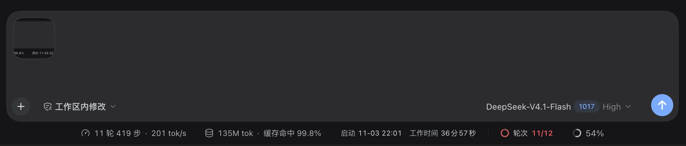
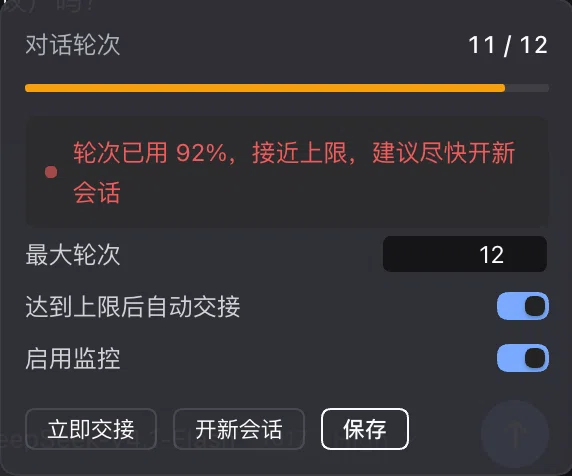
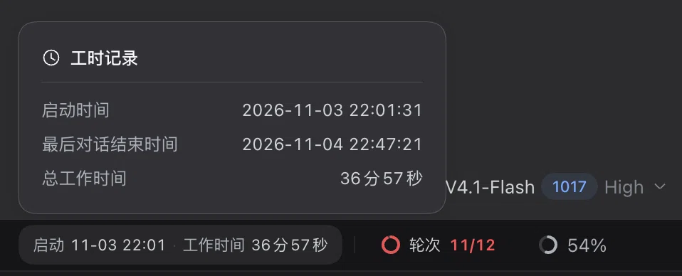
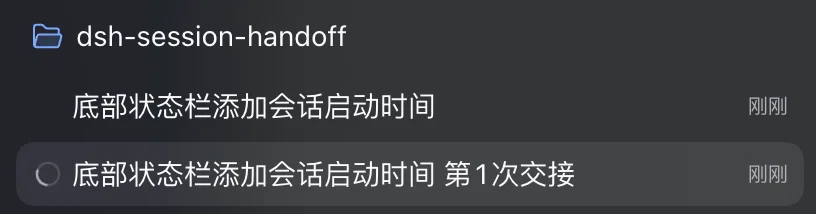

# 会话交接（Session Handoff）· DSH 插件

> 在 DSH 输入框下方常驻状态栏，显示会话启动时间、工作时间与对话轮次；到上限自动交接，让任务在同一工作区的新会话里继续。
> A DeepSeek Harness plugin that shows the session start time, accumulated work time, and turn count, and hands the task off to a fresh session in the same workspace at a configurable limit.

[效果展示](#效果展示) · [安装](#安装) · [更新](#更新) · [技术文档](docs/TECHNICAL.md) · [License](#license)

## 效果展示

状态栏常驻显示启动时间、工作时间、轮次与上下文占用；接近上限时，轮次转为警示色。




<p>
  
  &nbsp;&nbsp;
  
  &nbsp;&nbsp;
  
</p>

*左：轮次设置与自动交接 · 中：工时记录（启动 / 最后对话结束 / 总工作时间） · 右：交接后的新会话落在原工作区，标题沿用「原标题 第N次交接」*

## 安装

需要 DSH 0.2.x 的 Web / 桌面 profile。

**方式一：克隆后用 link 安装（推荐，以后更新最省事）**

```bash
git clone https://github.com/xiaohui-zhangxh/dsh-session-handoff.git
dsh plugin --profile desktop add "$(pwd)/dsh-session-handoff"
```

安装完成后完整重启 DSH。

**方式二：在 DSH 的 Plugins 页安装**

侧栏 → Plugins → Add plugin，填入仓库地址：

```
https://github.com/xiaohui-zhangxh/dsh-session-handoff
```

安装并启用后，完整重启 DSH。

## 更新

DSH 不会自动更新第三方插件，需要手动更新一次。

**方式一（link 安装）**

```bash
cd dsh-session-handoff
git pull
```

然后完整重启 DSH。若新版本改动了依赖，再执行 `dsh plugin --profile desktop install`。

**方式二（Plugins 页安装）**

Plugins → 该插件 → 卸载 → Add plugin 重新填入仓库地址 → 启用 → 完整重启 DSH。

> 为什么都需要重启：宿主半边不会热重载；浏览器半边会自动换新，重启后最稳妥。

## 技术文档

显示规则、面板行为、交接流程、设置项、本机接口、测试与已知边界见 [docs/TECHNICAL.md](docs/TECHNICAL.md)。

## License

[MIT](LICENSE)
